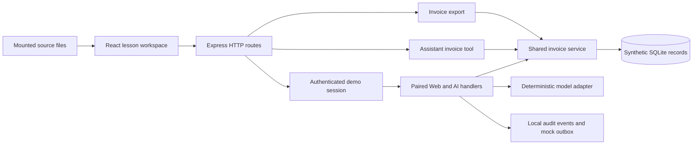

# Implementation and demonstration plan

The final deliverables are a Do Say See demo flow document and a silent screen recording with permanent small subtitles. The application and repository history supply reproducible evidence for those deliverables.

## Framework and patterns

Use Node 24, Express 5, React, Vite, and Node SQLite. Pin dependencies in the lockfile. Use a modular monolith: transport routes call services, services own policy, and parameterized storage functions own persistence. Model responses use a deterministic adapter. Actual application controls remain executable. The app binds to loopback by default and uses synthetic records only.

## Architecture

## Review loop

1. Bootstrap the repository and commit the configuration.
2. Build and test the fifteen lessons. Keep the shared invoice service scoped in the baseline.
3. Open and review the application PR. Merge the isolated teaching baseline.
4. Introduce the shared invoice authorization regression on a separate branch. Run the CodeRabbit CLI before pushing it.
5. Open the regression PR and inspect findings, Security Architecture Review, and Blast Radius.
6. Ask the CodeRabbit PR agent to create a Jira Bug in the privately configured demo destination, with the PR evidence and acceptance criteria. Verify the returned issue.
7. Configure the native Security check and demonstrate real enforcement where repository permissions permit it.
8. Deep Scan the committed regression branch. Inspect the matching finding and Attack Surface evidence.
9. Generate and execute the runtime reproducer. Record the actual tested revision and result.
10. Fix the shared service, test all consumers, re-review, and scan the remediation revision. Preserve the vulnerable revision as a replay tag.
11. Demonstrate a narrow dismissal on a separate observed lab finding.
12. Rehearse and record the final flow. Build the document using actual screenshots and links.

## Recording

Use the main display at its highest available resolution. Record full screen with large fonts, no audio, click indicators, and small permanent subtitles. Show navigation and typed commands. Trim idle waits with labelled time cuts. Keep individual idle pauses below two seconds. Record real product output and date observations.

## Evidence and completion

Retain CLI output, review links, commit IDs, scan IDs, Jira links, and test results. Separate generated reproducer instructions from executed runtime evidence. Deliver the reviewed document and MP4, together with replay instructions. Report feature or permission limitations explicitly if a product action cannot be completed.
